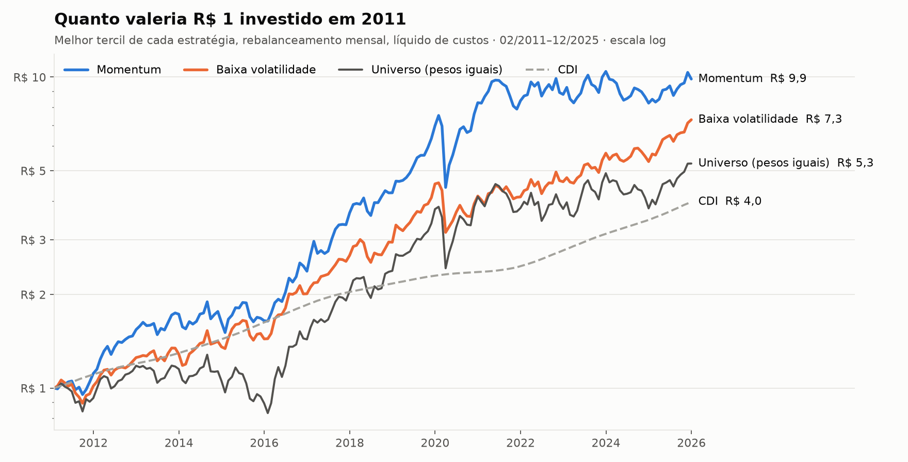
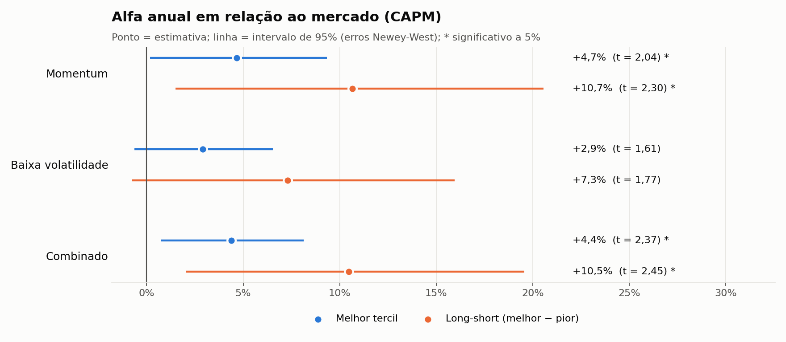
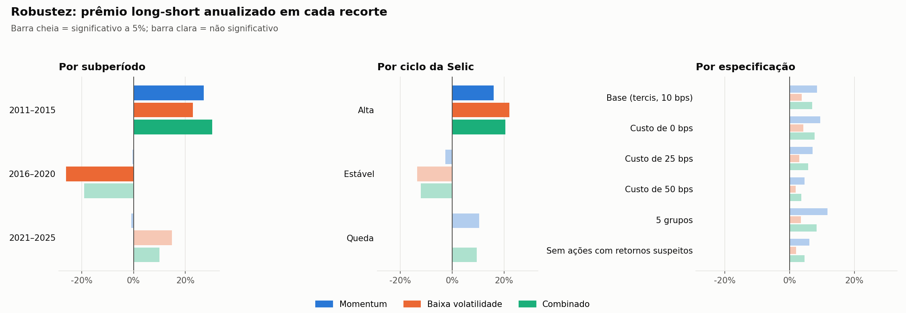

# Factor Investing in Brazil: Momentum, Low Volatility, Value and Quality

**A backtest of factor strategies in the Brazilian stock market (2011–2025)**

[🇧🇷 Português](README.md) · 🇺🇸 English

---

Do the best-documented factors in the international literature work on B3, Brazil's stock exchange? This project tests **momentum** and **low volatility** (from price data) and **value** and **quality** (from financial statements filed with the CVM, Brazil's securities regulator) in a 15-year backtest, net of transaction costs, with significance tests, alpha regressions and robustness checks.

> Code comments and chart labels are in Portuguese. R$ = Brazilian real; CDI = Brazil's interbank rate, used as the risk-free rate.

  

## Key results

| | Momentum | Low vol. | Value | Quality | Multifactor | Universe | CDI |
|---|:---:|:---:|:---:|:---:|:---:|:---:|:---:|
| **Annual return** | **16.6%** | 14.3% | 12.0% | 12.1% | 15.9% | 11.8% | 9.7% |
| **Annual volatility** | 21.1% | **16.6%** | 27.4% | 20.7% | 19.1% | 21.9% | — |
| **Sharpe ratio** | **0.40** | 0.33 | 0.21 | 0.21 | 0.39 | 0.20 | — |
| **Max drawdown** | −41.3% | **−30.7%** | −55.9% | −35.5% | −32.4% | −36.5% | — |
| **Annual alpha (CAPM)** | **+4.8%** \* | +2.6% | +0.7% | +0.4% | +3.9% \* | — | — |

Top tercile of each strategy, 2011–2025, monthly rebalancing, net of costs. Universe = all eligible stocks, equal-weighted. \* significant at 5%.

- 📈 **Momentum is the only factor that generates alpha on its own.** Its top tercile beats the market by 4.8% a year on a risk-adjusted basis (t = 2.07). Strategies that include it also have significant alpha: combined with low volatility, 4.3% (t = 2.56); multifactor, 3.9% (t = 2.42).
- 🛡️ **Low volatility earns more than the universe with less risk:** the lowest volatility and shallowest drawdown of all portfolios. Its 2.6% alpha is not significant (t = 1.43).
- 💤 **Value and quality earned no premium over the full period:** alpha near zero (t ≈ 0.3) and returns in line with the universe. Value also carries more market risk (beta of 1.19), because cheap Brazilian stocks are mostly state-owned companies, banks and commodity producers.
- ⚠️ **Momentum's edge comes from risk adjustment.** Its simple excess return over the universe (4.2% a year) is not significant (t = 1.61). Alpha shows up because the portfolio has a beta below 1.

  

## Robustness: does the result hold up?

Partly. The tests below show where each result is fragile.

  

- **Factors take turns.** Momentum and low volatility concentrate their gains in 2011–2015 (long-short premiums of 27% and 22% a year). Value does the opposite: it loses 15% a year in 2011–2015 (t = −1.96), as cheap commodity and state-owned stocks kept falling, and gains 11% a year in 2021–2025 (t = 2.08). Quality loses 16% a year in 2016–2020 (t = −2.30).
- **Stronger in Selic hiking cycles.** In months of rising policy rates, the low-volatility top tercile beat the universe by 10.3% a year (t = 2.79), and the multifactor by 8.5% (t = 2.38). With stable or falling rates, no excess return is significant.
- **Sensitive to costs.** Momentum's excess over the universe falls from 4.5% a year with no costs to 2.6% at 50 bps per side.
- **Not driven by data errors, but dependent on a few stocks.** Cleaning handled 10 extreme daily returns in 5 stocks ([report](resultados/limpeza_dados.csv)). With or without cleaning, the momentum long-short premium is 8.7% a year. Without those 5 stocks, it falls to 6.3%.
- **Quintiles** give similar or larger premiums (11.7% a year for momentum), also without statistical significance in the long-short.

Tables: [`robustez_subperiodos.csv`](resultados/robustez_subperiodos.csv), [`robustez_ciclos_selic.csv`](resultados/robustez_ciclos_selic.csv) and [`robustez_especificacoes.csv`](resultados/robustez_especificacoes.csv). Full tables in [`resultados/`](resultados/) (semicolon-separated CSVs, decimal comma).

## Methodology

| Step | Choice |
|---|---|
| **Universe** | 61 liquid stocks listed on B3 |
| **Period** | 2011–2025 (178–179 months); 2010 is used only to compute the first signals |
| **Eligibility** | ≥ 1 year of history, median daily traded value ≥ R$ 5M, price ≥ R$ 1 |
| **Momentum 12-1** | Cumulative return over the past 12 months, skipping the most recent one (short-term reversal) |
| **Low volatility** | Annualized daily volatility over the past 252 trading days |
| **Value** | Average z-score of B/M (book equity ÷ market cap) and E/P (earnings ÷ market cap), using equity and earnings attributable to controlling shareholders |
| **Quality** | Average z-score of ROE and low leverage (1 − equity/assets). Banks and insurers use ROE only |
| **Combined / Multifactor** | Average z-score of momentum and low volatility / of all four factors |
| **Fundamentals** | Annual statements (DFP) from the CVM. A fiscal year enters the signal only after its filing date, and data older than 18 months is dropped |
| **Market cap** | Share count from the Reference Form (paid-in capital) × split-unadjusted price. Share-count changes are aligned with split dates, and inconsistent stretches are dropped ([report](resultados/fundamentos_trechos_descartados.csv)) |
| **Portfolios** | Equal-weighted terciles, rebalanced monthly |
| **Costs** | 10 bps per side on actual turnover |
| **Price cleaning** | Daily returns beyond ±50% in the adjusted price: a spike that reverts within 5 trading days is removed; a permanent jump (mishandled split or spin-off) has that day's return set to zero |
| **Benchmark** | Equal-weighted portfolio of all eligible stocks, with dividends and costs |
| **Risk-free rate** | CDI (Central Bank of Brazil, SGS series 12) |
| **Inference** | CAPM alpha with Newey-West standard errors; optional NEFIN-USP 5-factor model |

Signals use only information available at the end of month *t*; portfolios are held during *t+1*.

<b>🧪 Validation: how I know the code doesn't "see the future"</b>

 

`tests/test_pipeline.py` runs seven checks on a simulated market:

1. **Random signal:** the long-short return is not significant (t ≈ 0).
2. **Signal that peeks at next month:** returns are absurdly high, confirming the time alignment: the code only makes "free money" when it is given future information.
3. **No look-ahead in prices:** a date's signals don't change when all later data is deleted.
4. **Costs:** higher transaction costs reduce the long-short return, since both legs pay costs.
5. **Data cleaning:** an unadjusted split is neutralized, a reverting spike is removed, and clean data is left untouched.
6. **Market cap:** splits, units, misaligned approval dates and typos in share counts are handled without implausible jumps.
7. **No look-ahead in fundamentals:** a fiscal year shows up in the signal only after its filing date, and signals don't change when later data is deleted.

On real data, the code also writes audit reports: the CNPJ (company ID) matched to each ticker, signal coverage by year, share-count adjustments, and a snapshot of last-month ratios (P/E, B/M, ROE) that can be checked against public sources. Tests run automatically on GitHub Actions on every code change.

## How to run

| Option | How |
|---|---|
| **Browser** (no install) | [Open in Colab](https://colab.research.google.com/github/Regis-git-wq/backtest-fatores-b3/blob/main/rodar_no_colab.ipynb) → *Runtime → Run all* |
| **GitHub** | *Actions → Rodar backtest → Run workflow*; results are saved to `resultados/` |
| **Local** | `pip install -r requirements.txt`, then `python main.py` (or `python main.py --sintetico` to run offline) |

## Limitations

- **Survivorship bias:** the universe uses currently listed companies, which inflates absolute returns. The effect is smaller for comparisons between terciles and against the universe, which share the same bias.
- **Annual fundamentals:** with DFP data, value and quality signals can be up to 15 months old. Quarterly data (ITR) would make them timelier.
- **Restatements:** each statement's latest version is used as of its first filing date. If a company later corrected its figures, there is a small amount of look-ahead.
- **Approximate market cap:** price of the traded share class × total shares (common + preferred). In 10 cases, inconsistent stretches were dropped rather than corrected.
- **Yahoo Finance data:** adjusted prices contain occasional errors. Cleaning handles moves beyond ±50% in a day, but smaller errors slip through.
- **Small universe:** terciles of about 20 stocks make results sensitive to a few names.
- **Simplified costs:** a flat bps cost, with no market-impact model.

## Next steps

- [x] **Value** and **quality** factors from CVM financial statements
- [x] Robustness: subperiods, Selic (policy rate) cycles, quintiles, costs from 0 to 50 bps
- [ ] Quarterly fundamentals (ITR), for timelier signals
- [ ] Automatic download of NEFIN-USP factors, for 5-factor alphas
- [ ] Historical Ibovespa constituents, to remove survivorship bias
- [ ] Value weighting

## References

- Jegadeesh, N.; Titman, S. (1993). Returns to Buying Winners and Selling Losers. *Journal of Finance*.
- Fama, E.; French, K. (1992). The Cross-Section of Expected Stock Returns. *Journal of Finance*.
- Ang, A.; Hodrick, R.; Xing, Y.; Zhang, X. (2006). The Cross-Section of Volatility and Expected Returns. *Journal of Finance*.
- Frazzini, A.; Pedersen, L. H. (2014). Betting Against Beta. *Journal of Financial Economics*.
- Asness, C.; Frazzini, A.; Pedersen, L. H. (2019). Quality Minus Junk. *Review of Accounting Studies*.
- NEFIN-USP: risk factors for the Brazilian market.
- CVM Open Data Portal (DFP, FRE and FCA datasets).

---

Made by <a href="https://github.com/Regis-git-wq">Reginaldo</a>, Economics student at Ibmec-SP · MIT License

