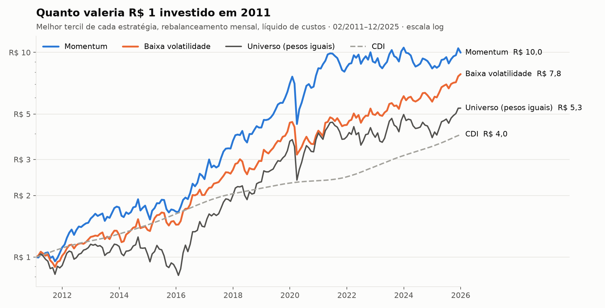
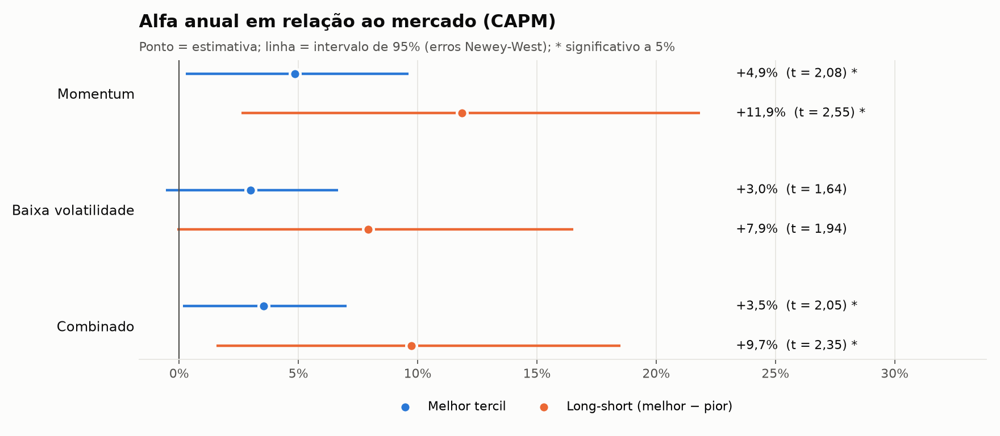

# Factor Investing in Brazil: Momentum and Low Volatility

**A backtest of factor strategies in the Brazilian stock market (2011–2025)**

[🇧🇷 Português](README.md) · 🇺🇸 English

---

Do **momentum** and **low-volatility** strategies, well documented in international markets, work on B3 (Brazil's stock exchange)? This project answers with a 15-year backtest, net of transaction costs, with significance tests and alpha regressions.

> Code comments and chart labels are in Portuguese. R$ = Brazilian real; CDI = Brazil's interbank rate, used as the risk-free rate.

  

## Key results

| | Momentum | Low volatility | Universe (equal-weighted) | CDI |
|---|:---:|:---:|:---:|:---:|
| **Annual return** | **16.7%** | 14.8% | 11.9% | 9.7% |
| **Annual volatility** | 21.0% | **16.9%** | 22.0% | — |
| **Sharpe ratio** | **0.41** | 0.36 | 0.20 | — |
| **Max drawdown** | −41.3% | **−30.7%** | −36.5% | — |
| **Annual alpha (CAPM)** | **+4.9%** \* | +3.0% | — | — |

Top tercile of each strategy, Feb 2011–Dec 2025, monthly rebalancing, net of costs. \* significant at 5%.

- 📈 **Momentum generates alpha.** The top tercile beats the market by 4.9% a year on a risk-adjusted basis (t = 2.08). The long-short portfolio (long the top tercile, short the bottom) earns 11.9% a year (t = 2.55).
- 🛡️ **Low volatility delivers market-like returns with less risk.** It has the lowest volatility and the shallowest drawdown of all portfolios, with alpha at the edge of significance (t = 1.64).
- ⚖️ **Long-short portfolios have negative market beta** (−0.37 for momentum, −0.73 for low volatility), because past losers and high-volatility stocks are more sensitive to the market.

  

Full tables in [`resultados/`](resultados/) (semicolon-separated CSVs, decimal comma).

## Methodology

| Step | Choice |
|---|---|
| **Universe** | 61 liquid stocks listed on B3 |
| **Period** | Feb 2011 – Dec 2025 (179 months); 2010 is used only to compute the first signals |
| **Eligibility** | ≥ 1 year of history, median daily traded value ≥ R$ 5M, price ≥ R$ 1 |
| **Momentum 12-1** | Cumulative return over the past 12 months, skipping the most recent one (short-term reversal) |
| **Low volatility** | Annualized daily volatility over the past 252 trading days |
| **Combined** | Average of the two signals' z-scores |
| **Portfolios** | Equal-weighted terciles, rebalanced monthly |
| **Costs** | 10 bps per side on actual turnover |
| **Benchmark** | Equal-weighted portfolio of all eligible stocks, with dividends and costs |
| **Risk-free rate** | CDI (Central Bank of Brazil, SGS series 12) |
| **Inference** | CAPM alpha with Newey-West standard errors; optional NEFIN-USP 5-factor model |

Signals use only information available at the end of month *t*; portfolios are held during *t+1*.

<b>🧪 Validation: how I know the code doesn't "see the future"</b>

 

`tests/test_pipeline.py` runs three checks on a simulated market:

1. **Random signal:** the long-short return is not significant (t ≈ 0).
2. **Signal that peeks at next month:** returns are absurdly high, confirming the time alignment: the code only makes "free money" when it is given future information.
3. **No look-ahead:** a date's signals don't change when all later data is deleted.

The simulated market embeds a known momentum effect, and the backtest recovers it (t ≈ 2.2). Tests run automatically on GitHub Actions on every code change.

## How to run

| Option | How |
|---|---|
| **Browser** (no install) | [Open in Colab](https://colab.research.google.com/github/Regis-git-wq/backtest-fatores-b3/blob/main/rodar_no_colab.ipynb) → *Runtime → Run all* |
| **GitHub** | *Actions → Rodar backtest → Run workflow*; results are saved to `resultados/` |
| **Local** | `pip install -r requirements.txt`, then `python main.py` (or `python main.py --sintetico` to run offline) |

## Limitations

- **Survivorship bias:** the universe uses currently listed companies, which inflates absolute returns. The effect is smaller for comparisons between terciles and against the universe, which share the same bias.
- **Yahoo Finance data:** 10 daily returns exceed ±50% ([list](resultados/retornos_suspeitos.csv)). Some are real corporate events (GPA spin-offs), others look like adjustment errors.
- **Small universe:** terciles of about 20 stocks make results sensitive to a few names.
- **Simplified costs:** a flat bps cost, with no market-impact model.

## Next steps

- [ ] **Value** and **quality** factors from CVM financial statements
- [ ] Historical Ibovespa constituents, to remove survivorship bias
- [ ] Robustness: subperiods, value weighting, quintiles, costs from 0 to 50 bps
- [ ] Performance across Selic (policy rate) hiking and easing cycles

## References

- Jegadeesh, N.; Titman, S. (1993). Returns to Buying Winners and Selling Losers. *Journal of Finance*.
- Ang, A.; Hodrick, R.; Xing, Y.; Zhang, X. (2006). The Cross-Section of Volatility and Expected Returns. *Journal of Finance*.
- Frazzini, A.; Pedersen, L. H. (2014). Betting Against Beta. *Journal of Financial Economics*.
- NEFIN-USP: risk factors for the Brazilian market.

---

Made by <a href="https://github.com/Regis-git-wq">Reginaldo</a>, Economics student at Ibmec-SP · MIT License

