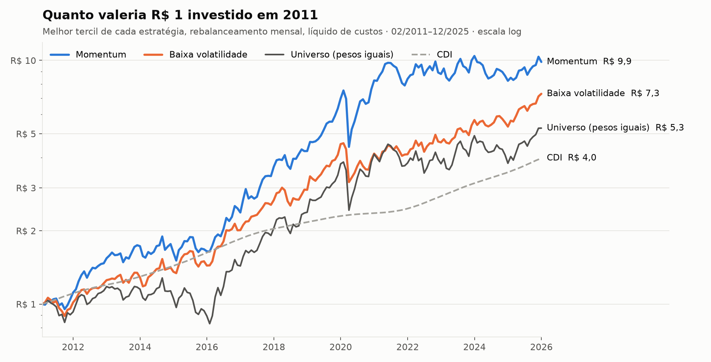
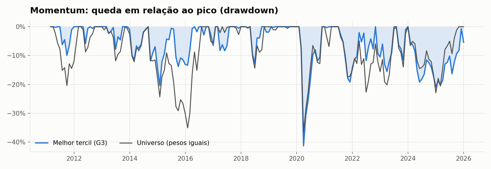
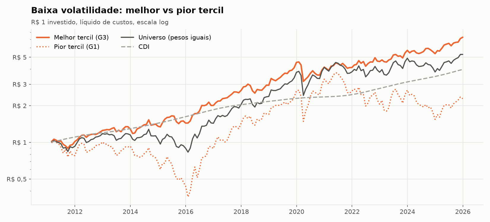
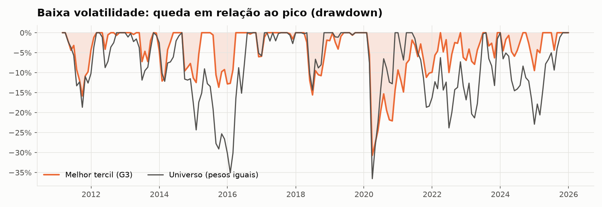

<div align="center">

# Fatores na B3: Momentum e Baixa Volatilidade

**Backtest de estratégias fatoriais no mercado acionário brasileiro (2011–2025)**

[](https://github.com/Regis-git-wq/backtest-fatores-b3/actions/workflows/backtest.yml)
[](https://colab.research.google.com/github/Regis-git-wq/backtest-fatores-b3/blob/main/rodar_no_colab.ipynb)


🇧🇷 Português · [🇺🇸 English](README.en.md)

</div>

---

Estratégias de **momentum** e **baixa volatilidade**, documentadas na literatura internacional, funcionam na B3? Este projeto responde com um backtest de 15 anos, líquido de custos de transação, com testes de significância, regressões de alfa e análises de robustez.

<p align="center">
  
</p>

## Principais resultados

| | Momentum | Baixa volatilidade | Combinado | Universo (pesos iguais) | CDI |
|---|:---:|:---:|:---:|:---:|:---:|
| **Retorno a.a.** | **16,4%** | 14,7% | 16,3% | 11,9% | 9,7% |
| **Volatilidade a.a.** | 21,0% | **16,9%** | 18,0% | 22,0% | — |
| **Sharpe** | 0,40 | 0,35 | **0,42** | 0,20 | — |
| **Drawdown máximo** | −41,3% | **−30,7%** | −32,1% | −36,5% | — |
| **Alfa a.a. (CAPM)** | +4,7% \* | +2,9% | +4,4% \* | — | — |

<sub>Melhor tercil de cada estratégia, fev/2011–dez/2025, rebalanceamento mensal, líquido de custos. \* significativo a 5%.</sub>

- 📈 **Momentum e a estratégia combinada geram alfa no período completo.** O melhor tercil de momentum supera o mercado em 4,7% a.a. ajustado ao risco (t = 2,04), e o combinado em 4,4% a.a. (t = 2,37).
- 🛡️ **Baixa volatilidade entrega mais retorno que o universo com menos risco:** a menor volatilidade e o menor drawdown entre as carteiras. O alfa de 2,9% a.a. não é significativo (t = 1,61).
- ⚠️ **O ganho vem do ajuste ao risco, não do retorno bruto.** O excesso de retorno simples sobre o universo (3,9% a.a. no momentum) não é significativo (t = 1,50). O alfa aparece porque as carteiras têm beta menor que 1.
- ⚖️ **As carteiras long-short têm beta negativo** (−0,37 no momentum e −0,74 na baixa volatilidade). O prêmio bruto do momentum é de 8,5% a.a. (t = 1,63), e o alfa de CAPM é de 10,7% a.a. (t = 2,30).

<p align="center">
  
</p>

## Robustez: o resultado se sustenta?

Em parte. Os testes abaixo mostram onde o resultado é frágil.

<p align="center">
  
</p>

- **Concentrado em 2011–2015.** Nesse período o prêmio long-short foi de 27% a.a. no momentum (t = 3,52) e 23% na baixa volatilidade (t = 2,63). De 2016 em diante, o momentum fica perto de zero, e a baixa volatilidade perdeu 26% a.a. em 2016–2020 (t = −2,22).
- **Melhor em ciclos de alta da Selic.** Nos meses de juros em alta, o melhor tercil de baixa volatilidade superou o universo em 10,8% a.a. (t = 2,88). Com juros estáveis ou em queda, nenhum excesso é significativo.
- **Sensível a custos.** O excesso do momentum sobre o universo cai de 4,3% a.a. sem custos para 2,4% com 50 bps por lado.
- **Sensível a poucas ações.** Sem as 5 ações com retornos suspeitos nos dados do Yahoo, o prêmio long-short do momentum cai de 8,5% para 6,1% a.a.
- **Quintis** dão prêmios parecidos ou maiores (11,7% a.a. no momentum), também sem significância estatística.

Tabelas: [`robustez_subperiodos.csv`](resultados/robustez_subperiodos.csv), [`robustez_ciclos_selic.csv`](resultados/robustez_ciclos_selic.csv) e [`robustez_especificacoes.csv`](resultados/robustez_especificacoes.csv).

<details>
<summary><b>📊 Gráficos por estratégia</b></summary>
<br>







</details>

Tabelas completas em [`resultados/`](resultados/). Os CSVs abrem direto no Excel.

## Metodologia

| Etapa | Escolha |
|---|---|
| **Universo** | 61 ações líquidas da B3 |
| **Período** | Fev/2011 a dez/2025 (179 meses); 2010 serve só para calcular os primeiros sinais |
| **Elegibilidade** | ≥ 1 ano de histórico, volume financeiro mediano ≥ R$ 5 mi/dia, preço ≥ R$ 1 |
| **Momentum 12-1** | Retorno acumulado dos últimos 12 meses, excluindo o mais recente, que tende a reverter |
| **Baixa volatilidade** | Volatilidade diária anualizada dos últimos 252 pregões |
| **Combinado** | Média dos z-scores dos dois sinais |
| **Carteiras** | Tercis com pesos iguais, rebalanceamento mensal |
| **Custos** | 10 bps por lado sobre o giro efetivo |
| **Limpeza de dados** | Retornos diários acima de ±50% no preço ajustado: pico que reverte em até 5 pregões é removido; salto permanente (desdobramento mal ajustado ou cisão) tem o retorno do dia zerado. Relatório em `limpeza_dados.csv` |
| **Benchmark** | Todas as ações elegíveis com pesos iguais, com dividendos e custos (comparação justa com as carteiras) |
| **Taxa livre de risco** | CDI (Banco Central, série SGS 12) |
| **Inferência** | Alfa de CAPM com erros-padrão Newey-West; modelo de 5 fatores do NEFIN-USP opcional |

O sinal usa apenas informação disponível até o fim do mês *t*, e a carteira é mantida em *t+1*.

<details>
<summary><b>🧪 Validação: como sei que o código não "vê o futuro"</b></summary>
<br>

`tests/test_pipeline.py` roda cinco testes num mercado simulado:

1. **Sinal aleatório:** a long-short não tem retorno significativo (t ≈ 0).
2. **Sinal que espia o mês seguinte:** o retorno sai absurdo. Isso confirma o alinhamento temporal, porque o código só ganha "de graça" quando recebe informação do futuro.
3. **Sem look-ahead:** os sinais de uma data não mudam quando os dados posteriores são apagados.
4. **Custos:** aumentar o custo de transação reduz o retorno da long-short, porque as duas pontas pagam custos.
5. **Limpeza de dados:** um desdobramento não ajustado é neutralizado, um pico que reverte é removido, e dados sem problema ficam intactos.

O mercado simulado embute um efeito de momentum conhecido, e o backtest o recupera (t ≈ 2,2). Os testes rodam automaticamente no GitHub Actions a cada alteração do código.

</details>

## Como rodar

| Opção | Como |
|---|---|
| **Navegador** (sem instalar nada) | [Abrir no Colab](https://colab.research.google.com/github/Regis-git-wq/backtest-fatores-b3/blob/main/rodar_no_colab.ipynb) → *Ambiente de execução → Executar tudo* |
| **GitHub** | *Actions → Rodar backtest → Run workflow*; os resultados são salvos em `resultados/` |
| **Computador** | `pip install -r requirements.txt` e depois `python main.py` (ou `python main.py --sintetico` para rodar offline) |

<details>
<summary><b>📁 Estrutura do projeto</b></summary>

```
config.py              parâmetros (universo, período, filtros, custos)
main.py                executa o backtest e gera tabelas e gráficos
src/dados.py           download e cache de preços (Yahoo Finance), CDI (BCB) e fatores NEFIN
src/fatores.py         sinais e filtro de elegibilidade
src/carteiras.py       formação das carteiras, retornos, giro e custos
src/metricas.py        métricas de desempenho e regressões
src/graficos.py        gráficos
src/robustez.py        subperíodos, ciclos da Selic, custos e especificações alternativas
tests/                 mercado simulado e testes de sanidade
rodar_no_colab.ipynb   roda o projeto no Google Colab
resultados/            saídas da última execução (CSV e PNG)
```

</details>

## Limitações

- **Viés de sobrevivência:** o universo usa empresas listadas hoje, o que infla os retornos absolutos. O efeito é menor nas comparações entre tercis e contra o universo, que compartilham o mesmo viés.
- **Dados do Yahoo Finance:** os preços ajustados têm erros pontuais. A limpeza automática trata os casos acima de ±50% num dia ([relatório](resultados/limpeza_dados.csv)), mas erros menores passam. A análise de robustez compara com os dados brutos.
- **Universo pequeno:** com tercis de cerca de 20 ações, os resultados ficam sensíveis a poucas empresas.
- **Custos simplificados:** o custo é fixo em bps, sem modelar o impacto de mercado.

## Próximos passos

- [ ] Fatores de **valor** e **qualidade** com demonstrações financeiras da CVM
- [ ] Universo pela composição histórica do Ibovespa, para eliminar o viés de sobrevivência
- [x] Robustez: subperíodos, ciclos da Selic, quintis, custos de 0 a 50 bps (tabelas `robustez_*.csv`)
- [ ] Ponderação por valor de mercado

## Referências

- Jegadeesh, N.; Titman, S. (1993). Returns to Buying Winners and Selling Losers. *Journal of Finance*.
- Ang, A.; Hodrick, R.; Xing, Y.; Zhang, X. (2006). The Cross-Section of Volatility and Expected Returns. *Journal of Finance*.
- Frazzini, A.; Pedersen, L. H. (2014). Betting Against Beta. *Journal of Financial Economics*.
- NEFIN-USP: fatores de risco para o mercado brasileiro.

---

<div align="center">
<sub>Feito por <a href="https://github.com/Regis-git-wq">Reginaldo</a>, estudante de Ciências Econômicas no Ibmec-SP · Licença MIT</sub>
</div>
