<div align="center">

# Fatores na B3: momentum, baixa volatilidade, valor e qualidade

**Backtest de estratégias fatoriais no mercado acionário brasileiro (2011–2025)**

[](https://github.com/Regis-git-wq/backtest-fatores-b3/actions/workflows/backtest.yml)
[](https://colab.research.google.com/github/Regis-git-wq/backtest-fatores-b3/blob/main/rodar_no_colab.ipynb)


🇧🇷 Português · [🇺🇸 English](README.en.md)

</div>

---

Os fatores mais documentados da literatura internacional funcionam na B3? Este projeto testa **momentum** e **baixa volatilidade** (com dados de preço) e **valor** e **qualidade** (com as demonstrações financeiras entregues à CVM) num backtest de 15 anos, líquido de custos de transação, com testes de significância, regressões de alfa e análises de robustez.

<p align="center">
  
</p>

## Principais resultados

| | Momentum | Baixa vol. | Valor | Qualidade | Multifator | Universo | CDI |
|---|:---:|:---:|:---:|:---:|:---:|:---:|:---:|
| **Retorno a.a.** | **16,6%** | 14,3% | 12,0% | 12,1% | 15,9% | 11,8% | 9,7% |
| **Volatilidade a.a.** | 21,1% | **16,6%** | 27,4% | 20,7% | 19,1% | 21,9% | — |
| **Sharpe** | **0,40** | 0,33 | 0,21 | 0,21 | 0,39 | 0,20 | — |
| **Drawdown máximo** | −41,3% | **−30,7%** | −55,9% | −35,5% | −32,4% | −36,5% | — |
| **Alfa a.a. (CAPM)** | **+4,8%** \* | +2,6% | +0,7% | +0,4% | +3,9% \* | — | — |

<sub>Melhor tercil de cada estratégia, 2011–2025, rebalanceamento mensal, líquido de custos. Universo = todas as ações elegíveis com pesos iguais. \* significativo a 5%.</sub>

- 📈 **Momentum é o único fator que gera alfa sozinho.** O melhor tercil supera o mercado em 4,8% a.a. ajustado ao risco (t = 2,07). As estratégias que o incluem também têm alfa significativo: combinado com baixa volatilidade, 4,3% a.a. (t = 2,56); multifator, 3,9% a.a. (t = 2,42).
- 🛡️ **Baixa volatilidade entrega mais retorno que o universo com menos risco:** a menor volatilidade e o menor drawdown entre as carteiras. O alfa de 2,6% a.a. não é significativo (t = 1,43).
- 💤 **Valor e qualidade não geraram prêmio no período completo:** alfa perto de zero (t ≈ 0,3) e retorno igual ao do universo. O fator valor ainda carrega mais risco de mercado (beta de 1,19), porque as ações baratas da B3 são sobretudo estatais, bancos e empresas de commodities.
- ⚠️ **O ganho do momentum vem do ajuste ao risco.** O excesso de retorno simples sobre o universo (4,2% a.a.) não é significativo (t = 1,61). O alfa aparece porque a carteira tem beta menor que 1.

<p align="center">
  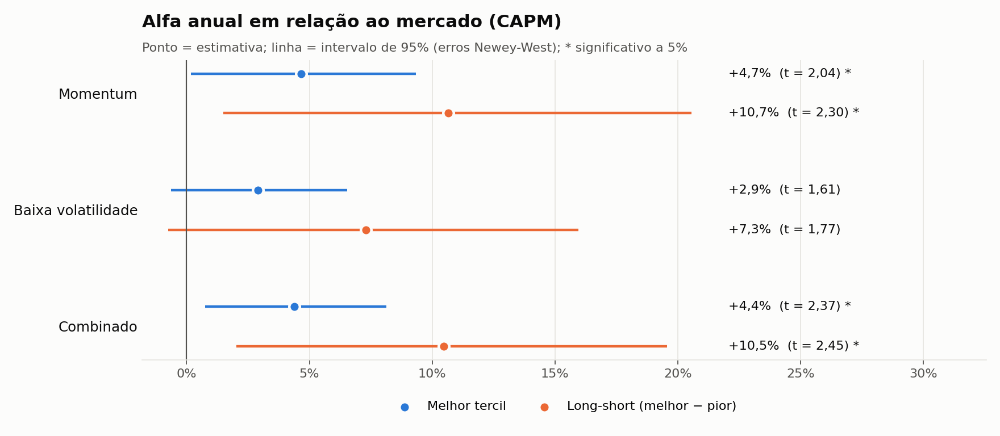
</p>

## Robustez: o resultado se sustenta?

Em parte. Os testes abaixo mostram onde cada resultado é frágil.

<p align="center">
  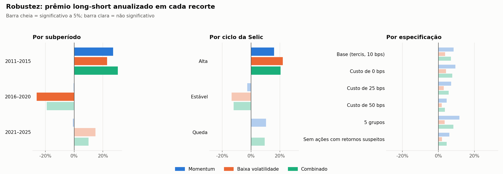
</p>

- **Os fatores se revezam no tempo.** Momentum e baixa volatilidade concentram o ganho em 2011–2015 (prêmio long-short de 27% e 22% a.a.). Valor faz o oposto: perde 15% a.a. em 2011–2015 (t = −1,96), quando ações baratas de commodities e estatais continuaram caindo, e ganha 11% a.a. em 2021–2025 (t = 2,08). Qualidade perde 16% a.a. em 2016–2020 (t = −2,30).
- **Melhor em ciclos de alta da Selic.** Nos meses de juros em alta, o melhor tercil de baixa volatilidade superou o universo em 10,3% a.a. (t = 2,79), e o multifator em 8,5% a.a. (t = 2,38). Com juros estáveis ou em queda, nenhum excesso é significativo.
- **Sensível a custos.** O excesso do momentum sobre o universo cai de 4,5% a.a. sem custos para 2,6% com 50 bps por lado.
- **Não depende dos erros de dados, mas depende de poucas ações.** A limpeza tratou 10 retornos diários extremos em 5 ações ([relatório](resultados/limpeza_dados.csv)). Com ou sem limpeza, o prêmio long-short do momentum fica em 8,7% a.a. Sem essas 5 ações, ele cai para 6,3% a.a.
- **Quintis** dão prêmios parecidos ou maiores (11,7% a.a. no momentum), também sem significância estatística na long-short.

Tabelas: [`robustez_subperiodos.csv`](resultados/robustez_subperiodos.csv), [`robustez_ciclos_selic.csv`](resultados/robustez_ciclos_selic.csv) e [`robustez_especificacoes.csv`](resultados/robustez_especificacoes.csv).

<details>
<summary><b>📊 Gráficos por estratégia</b></summary>
<br>

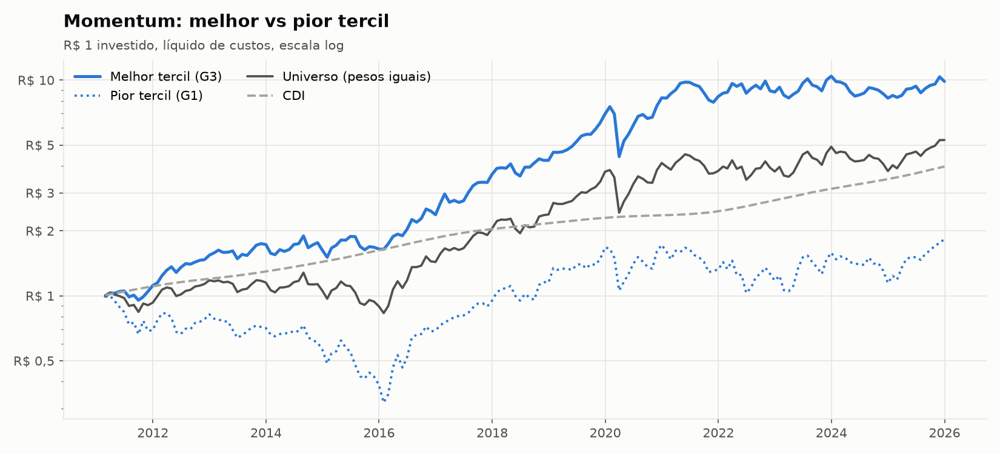


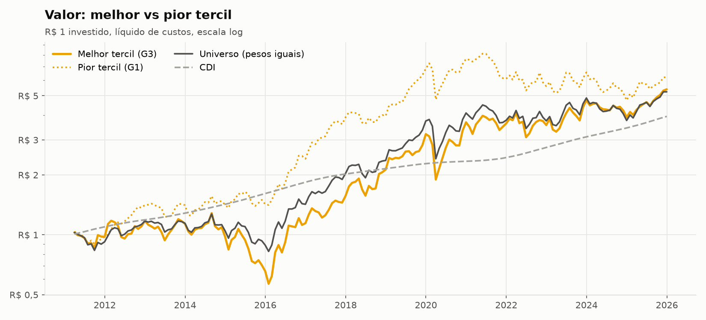
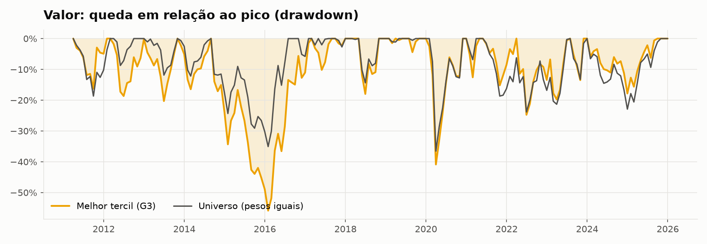
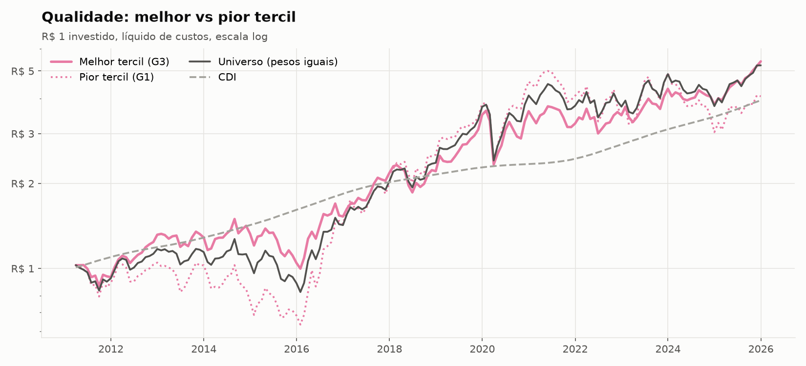
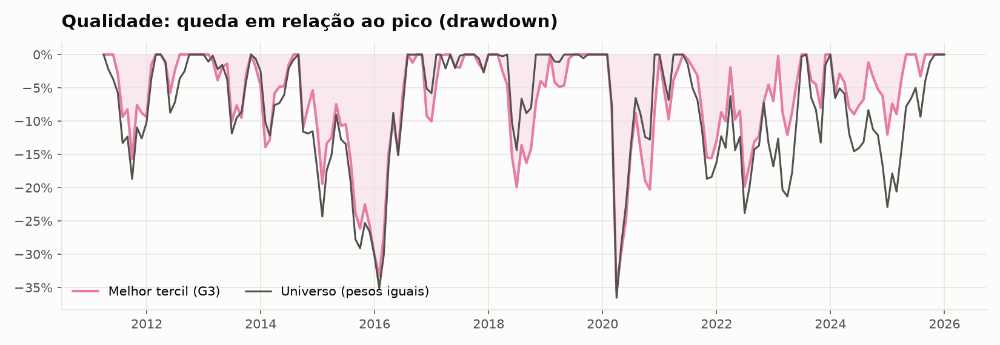
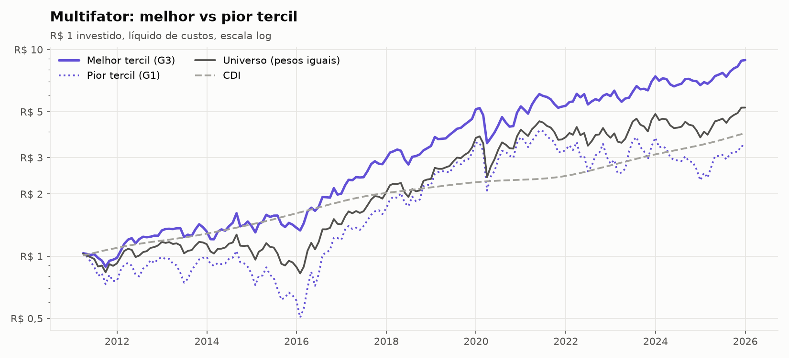
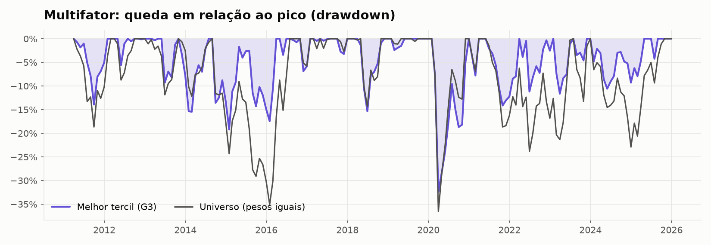
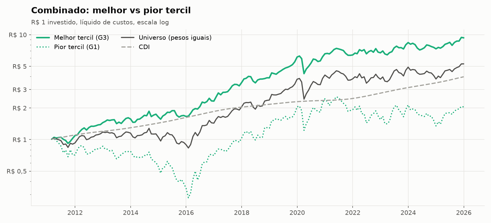
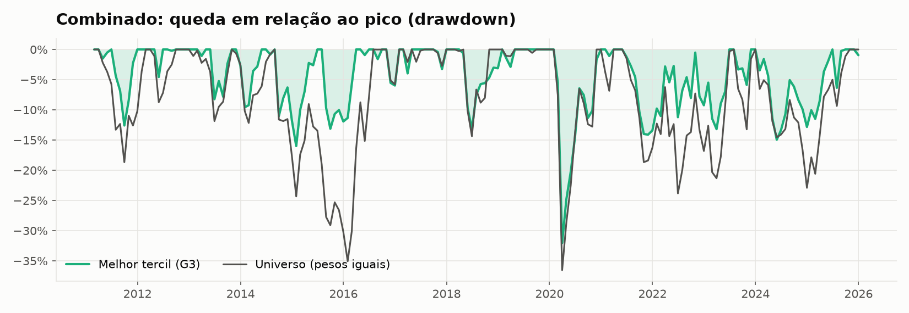

</details>

Tabelas completas em [`resultados/`](resultados/). Os CSVs abrem direto no Excel.

## Metodologia

| Etapa | Escolha |
|---|---|
| **Universo** | 61 ações líquidas da B3 |
| **Período** | 2011 a 2025 (178–179 meses); 2010 serve só para calcular os primeiros sinais |
| **Elegibilidade** | ≥ 1 ano de histórico, volume financeiro mediano ≥ R$ 5 mi/dia, preço ≥ R$ 1 |
| **Momentum 12-1** | Retorno acumulado dos últimos 12 meses, excluindo o mais recente, que tende a reverter |
| **Baixa volatilidade** | Volatilidade diária anualizada dos últimos 252 pregões |
| **Valor** | Média dos z-scores de B/M (patrimônio líquido ÷ valor de mercado) e E/P (lucro ÷ valor de mercado), com PL e lucro dos controladores |
| **Qualidade** | Média dos z-scores de ROE e de baixa alavancagem (1 − PL/ativo). Para bancos e seguradoras, só o ROE |
| **Combinado / Multifator** | Média dos z-scores de momentum e baixa volatilidade / dos quatro fatores |
| **Fundamentos** | Demonstrações anuais (DFP) da CVM. Um exercício só entra no sinal depois da data de entrega à CVM, e exercícios com mais de 18 meses são descartados |
| **Valor de mercado** | Nº de ações do Formulário de Referência (capital integralizado) × preço sem ajuste de desdobramento. Mudanças no nº de ações são alinhadas às datas de desdobramento, e trechos inconsistentes são descartados ([relatório](resultados/fundamentos_trechos_descartados.csv)) |
| **Carteiras** | Tercis com pesos iguais, rebalanceamento mensal |
| **Custos** | 10 bps por lado sobre o giro efetivo |
| **Limpeza de preços** | Retornos diários acima de ±50% no preço ajustado: pico que reverte em até 5 pregões é removido; salto permanente (desdobramento mal ajustado ou cisão) tem o retorno do dia zerado |
| **Benchmark** | Todas as ações elegíveis com pesos iguais, com dividendos e custos (comparação justa com as carteiras) |
| **Taxa livre de risco** | CDI (Banco Central, série SGS 12) |
| **Inferência** | Alfa de CAPM com erros-padrão Newey-West; modelo de 5 fatores do NEFIN-USP opcional |

O sinal usa apenas informação disponível até o fim do mês *t*, e a carteira é mantida em *t+1*.

<details>
<summary><b>🧪 Validação: como sei que o código não "vê o futuro"</b></summary>
<br>

`tests/test_pipeline.py` roda sete testes num mercado simulado:

1. **Sinal aleatório:** a long-short não tem retorno significativo (t ≈ 0).
2. **Sinal que espia o mês seguinte:** o retorno sai absurdo. Isso confirma o alinhamento temporal, porque o código só ganha "de graça" quando recebe informação do futuro.
3. **Sem look-ahead nos preços:** os sinais de uma data não mudam quando os dados posteriores são apagados.
4. **Custos:** aumentar o custo de transação reduz o retorno da long-short, porque as duas pontas pagam custos.
5. **Limpeza de dados:** um desdobramento não ajustado é neutralizado, um pico que reverte é removido, e dados sem problema ficam intactos.
6. **Valor de mercado:** desdobramentos, units, datas de aprovação desalinhadas e erros de digitação no nº de ações são tratados sem saltos implausíveis.
7. **Sem look-ahead nos fundamentos:** um exercício só aparece no sinal depois da data de entrega, e os sinais não mudam quando os dados posteriores são apagados.

Com os dados reais, o código também gera relatórios de auditoria: o ticker ligado a cada CNPJ, a cobertura dos sinais por ano, os ajustes no nº de ações e uma foto dos indicadores no último mês (P/L, B/M, ROE), que dá para conferir com fontes públicas. Os testes rodam automaticamente no GitHub Actions a cada alteração do código.

</details>

## Como rodar

| Opção | Como |
|---|---|
| **Navegador** (sem instalar nada) | [Abrir no Colab](https://colab.research.google.com/github/Regis-git-wq/backtest-fatores-b3/blob/main/rodar_no_colab.ipynb) → *Ambiente de execução → Executar tudo* |
| **GitHub** | *Actions → Rodar backtest → Run workflow*; os resultados são salvos em `resultados/` |
| **Computador** | `pip install -r requirements.txt` e depois `python main.py` (ou `python main.py --sintetico` para rodar offline) |

<details>
<summary><b>📁 Estrutura do projeto</b></summary>

```
config.py              parâmetros (universo, período, filtros, custos)
main.py                executa o backtest e gera tabelas e gráficos
src/dados.py           preços e desdobramentos (Yahoo Finance), CDI (BCB), limpeza de preços
src/fundamentos.py     dados da CVM: demonstrações, nº de ações, valor de mercado, sinais de valor e qualidade
src/fatores.py         sinais de preço e filtro de elegibilidade
src/carteiras.py       formação das carteiras, retornos, giro e custos
src/metricas.py        métricas de desempenho e regressões
src/robustez.py        subperíodos, ciclos da Selic, custos e especificações alternativas
src/graficos.py        gráficos
tests/                 mercado simulado e testes de sanidade
rodar_no_colab.ipynb   roda o projeto no Google Colab
resultados/            saídas da última execução (CSV e PNG)
```

</details>

## Limitações

- **Viés de sobrevivência:** o universo usa empresas listadas hoje, o que infla os retornos absolutos. O efeito é menor nas comparações entre tercis e contra o universo, que compartilham o mesmo viés.
- **Fundamentos anuais:** com a DFP, o sinal de valor e qualidade pode ter até 15 meses. Dados trimestrais (ITR) deixariam o sinal mais atual.
- **Reapresentações:** usa a versão mais recente de cada demonstração na data da primeira entrega. Se a empresa corrigiu números depois, há um pequeno uso de informação futura.
- **Valor de mercado aproximado:** usa o preço da classe negociada × o total de ações (ON + PN). Em 10 casos, trechos inconsistentes foram descartados em vez de corrigidos.
- **Dados do Yahoo Finance:** os preços ajustados têm erros pontuais. A limpeza trata os casos acima de ±50% num dia, mas erros menores passam.
- **Universo pequeno:** com tercis de cerca de 20 ações, os resultados ficam sensíveis a poucas empresas.
- **Custos simplificados:** o custo é fixo em bps, sem modelar o impacto de mercado.

## Próximos passos

- [x] Fatores de **valor** e **qualidade** com demonstrações financeiras da CVM
- [x] Robustez: subperíodos, ciclos da Selic, quintis, custos de 0 a 50 bps
- [ ] Fundamentos trimestrais (ITR), para um sinal mais atual
- [ ] Fatores do NEFIN-USP baixados automaticamente, para o alfa de 5 fatores
- [ ] Universo pela composição histórica do Ibovespa, para eliminar o viés de sobrevivência
- [ ] Ponderação por valor de mercado

## Referências

- Jegadeesh, N.; Titman, S. (1993). Returns to Buying Winners and Selling Losers. *Journal of Finance*.
- Fama, E.; French, K. (1992). The Cross-Section of Expected Stock Returns. *Journal of Finance*.
- Ang, A.; Hodrick, R.; Xing, Y.; Zhang, X. (2006). The Cross-Section of Volatility and Expected Returns. *Journal of Finance*.
- Frazzini, A.; Pedersen, L. H. (2014). Betting Against Beta. *Journal of Financial Economics*.
- Asness, C.; Frazzini, A.; Pedersen, L. H. (2019). Quality Minus Junk. *Review of Accounting Studies*.
- NEFIN-USP: fatores de risco para o mercado brasileiro.
- CVM: Portal de Dados Abertos (DFP, FRE e FCA).

---

<div align="center">
<sub>Feito por <a href="https://github.com/Regis-git-wq">Reginaldo</a>, estudante de Ciências Econômicas no Ibmec-SP · Licença MIT</sub>
</div>
