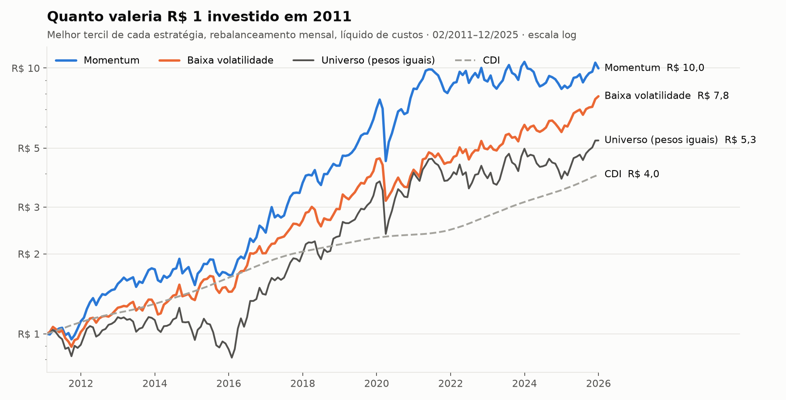
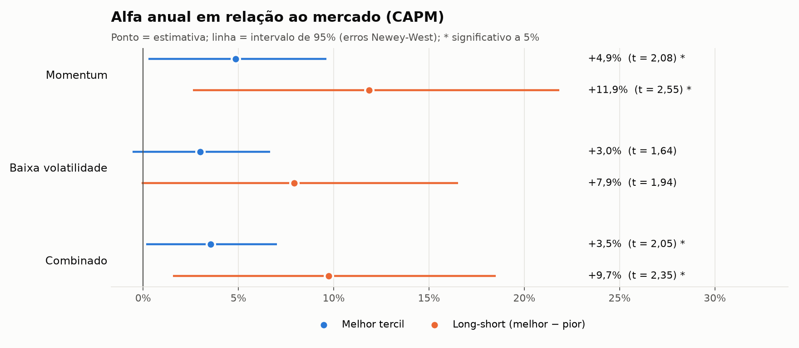
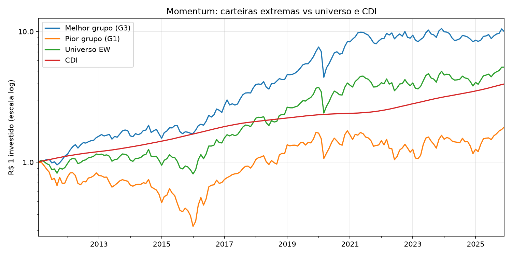
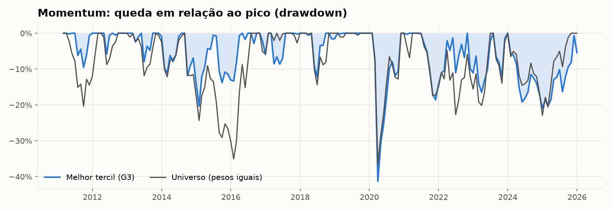
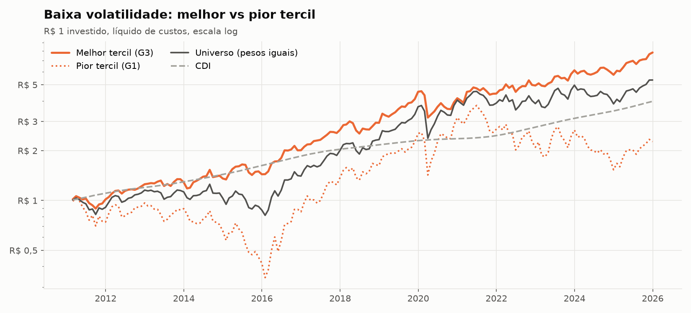
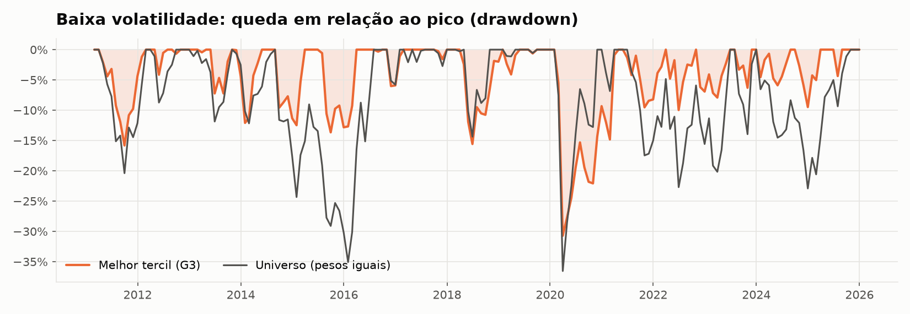
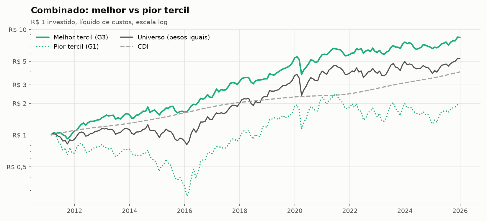
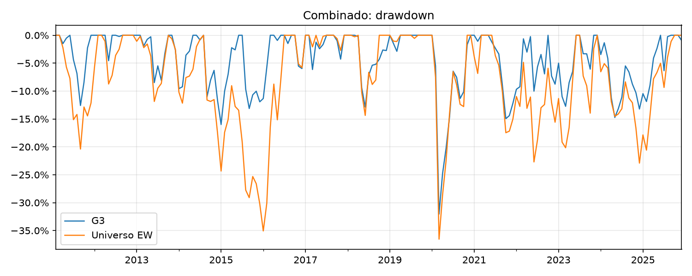

<div align="center">

# Fatores na B3: Momentum e Baixa Volatilidade

**Backtest de estratégias fatoriais no mercado acionário brasileiro (2011–2025)**

[](https://github.com/Regis-git-wq/backtest-fatores-b3/actions/workflows/backtest.yml)
[](https://colab.research.google.com/github/Regis-git-wq/backtest-fatores-b3/blob/main/rodar_no_colab.ipynb)


🇧🇷 Português · [🇺🇸 English](README.en.md)

</div>

---

Estratégias de **momentum** e **baixa volatilidade**, documentadas na literatura internacional, funcionam na B3? Este projeto responde com um backtest de 15 anos, líquido de custos de transação, com testes de significância e regressões de alfa.

<p align="center">
  
</p>

## Principais resultados

| | Momentum | Baixa volatilidade | Universo (pesos iguais) | CDI |
|---|:---:|:---:|:---:|:---:|
| **Retorno a.a.** | **16,7%** | 14,8% | 11,9% | 9,7% |
| **Volatilidade a.a.** | 21,0% | **16,9%** | 22,0% | — |
| **Sharpe** | **0,41** | 0,36 | 0,20 | — |
| **Drawdown máximo** | −41,3% | **−30,7%** | −36,5% | — |
| **Alfa a.a. (CAPM)** | **+4,9%** \* | +3,0% | — | — |

<sub>Melhor tercil de cada estratégia, fev/2011–dez/2025, rebalanceamento mensal, líquido de custos. \* significativo a 5%.</sub>

- 📈 **Momentum gera alfa.** O melhor tercil supera o mercado em 4,9% a.a. ajustado ao risco (t = 2,08). A carteira long-short, que compra o melhor tercil e vende o pior, chega a 11,9% a.a. (t = 2,55).
- 🛡️ **Baixa volatilidade entrega retorno de mercado com menos risco.** Tem a menor volatilidade e o menor drawdown entre todas as carteiras, com alfa no limite da significância (t = 1,64).
- ⚖️ **As carteiras long-short têm beta negativo** (−0,37 no momentum e −0,73 na baixa volatilidade): as ações perdedoras e as mais voláteis são mais sensíveis ao mercado.

<p align="center">
  
</p>

<details>
<summary><b>📊 Gráficos por estratégia</b></summary>
<br>








</details>

Tabelas completas em [`resultados/`](resultados/). Os CSVs abrem direto no Excel.

## Metodologia

| Etapa | Escolha |
|---|---|
| **Universo** | 61 ações líquidas da B3 |
| **Período** | Fev/2011 a dez/2025 (179 meses); 2010 serve só para calcular os primeiros sinais |
| **Elegibilidade** | ≥ 1 ano de histórico, volume financeiro mediano ≥ R$ 5 mi/dia, preço ≥ R$ 1 |
| **Momentum 12-1** | Retorno acumulado dos últimos 12 meses, excluindo o mais recente, que tende a reverter |
| **Baixa volatilidade** | Volatilidade diária anualizada dos últimos 252 pregões |
| **Combinado** | Média dos z-scores dos dois sinais |
| **Carteiras** | Tercis com pesos iguais, rebalanceamento mensal |
| **Custos** | 10 bps por lado sobre o giro efetivo |
| **Benchmark** | Todas as ações elegíveis com pesos iguais, com dividendos e custos (comparação justa com as carteiras) |
| **Taxa livre de risco** | CDI (Banco Central, série SGS 12) |
| **Inferência** | Alfa de CAPM com erros-padrão Newey-West; modelo de 5 fatores do NEFIN-USP opcional |

O sinal usa apenas informação disponível até o fim do mês *t*, e a carteira é mantida em *t+1*.

<details>
<summary><b>🧪 Validação: como sei que o código não "vê o futuro"</b></summary>
<br>

`tests/test_pipeline.py` roda três testes num mercado simulado:

1. **Sinal aleatório:** a long-short não tem retorno significativo (t ≈ 0).
2. **Sinal que espia o mês seguinte:** o retorno sai absurdo. Isso confirma o alinhamento temporal, porque o código só ganha "de graça" quando recebe informação do futuro.
3. **Sem look-ahead:** os sinais de uma data não mudam quando os dados posteriores são apagados.

O mercado simulado embute um efeito de momentum conhecido, e o backtest o recupera (t ≈ 2,2). Os testes rodam automaticamente no GitHub Actions a cada alteração do código.

</details>

## Como rodar

| Opção | Como |
|---|---|
| **Navegador** (sem instalar nada) | [Abrir no Colab](https://colab.research.google.com/github/Regis-git-wq/backtest-fatores-b3/blob/main/rodar_no_colab.ipynb) → *Ambiente de execução → Executar tudo* |
| **GitHub** | *Actions → Rodar backtest → Run workflow*; os resultados são salvos em `resultados/` |
| **Computador** | `pip install -r requirements.txt` e depois `python main.py` (ou `python main.py --sintetico` para rodar offline) |

<details>
<summary><b>📁 Estrutura do projeto</b></summary>

```
config.py              parâmetros (universo, período, filtros, custos)
main.py                executa o backtest e gera tabelas e gráficos
src/dados.py           download e cache de preços (Yahoo Finance), CDI (BCB) e fatores NEFIN
src/fatores.py         sinais e filtro de elegibilidade
src/carteiras.py       formação das carteiras, retornos, giro e custos
src/metricas.py        métricas de desempenho e regressões
src/graficos.py        gráficos
tests/                 mercado simulado e testes de sanidade
rodar_no_colab.ipynb   roda o projeto no Google Colab
resultados/            saídas da última execução (CSV e PNG)
```

</details>

## Limitações

- **Viés de sobrevivência:** o universo usa empresas listadas hoje, o que infla os retornos absolutos. O efeito é menor nas comparações entre tercis e contra o universo, que compartilham o mesmo viés.
- **Dados do Yahoo Finance:** há 10 retornos diários acima de ±50% ([lista](resultados/retornos_suspeitos.csv)). Parte é evento real, como as cisões do GPA, e parte parece erro de ajuste.
- **Universo pequeno:** com tercis de cerca de 20 ações, os resultados ficam sensíveis a poucas empresas.
- **Custos simplificados:** o custo é fixo em bps, sem modelar o impacto de mercado.

## Próximos passos

- [ ] Fatores de **valor** e **qualidade** com demonstrações financeiras da CVM
- [ ] Universo pela composição histórica do Ibovespa, para eliminar o viés de sobrevivência
- [ ] Robustez: subperíodos, ponderação por valor de mercado, quintis, custos de 0 a 50 bps
- [ ] Desempenho em ciclos de alta e queda da Selic

## Referências

- Jegadeesh, N.; Titman, S. (1993). Returns to Buying Winners and Selling Losers. *Journal of Finance*.
- Ang, A.; Hodrick, R.; Xing, Y.; Zhang, X. (2006). The Cross-Section of Volatility and Expected Returns. *Journal of Finance*.
- Frazzini, A.; Pedersen, L. H. (2014). Betting Against Beta. *Journal of Financial Economics*.
- NEFIN-USP: fatores de risco para o mercado brasileiro.

---

<div align="center">
<sub>Feito por <a href="https://github.com/Regis-git-wq">Reginaldo</a>, estudante de Ciências Econômicas no Ibmec-SP · Licença MIT</sub>
</div>
